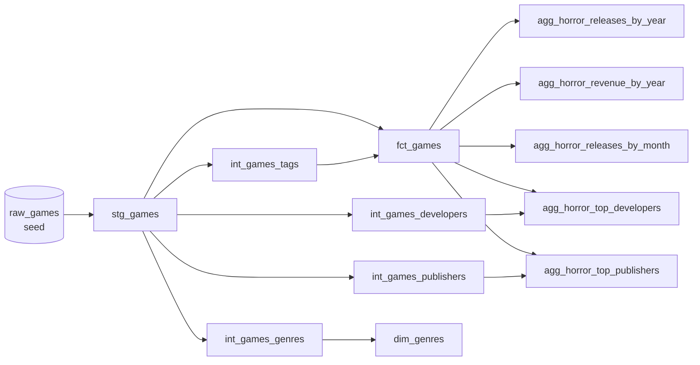
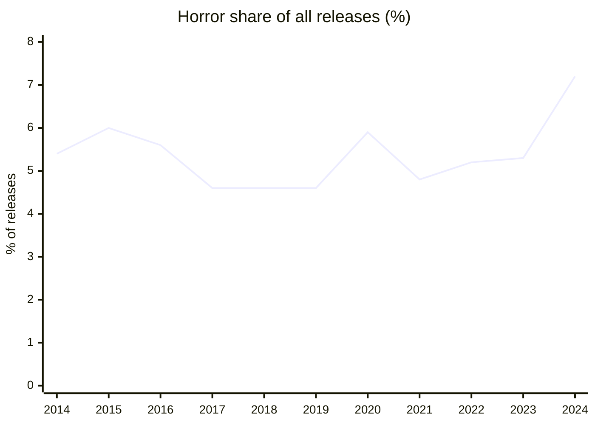
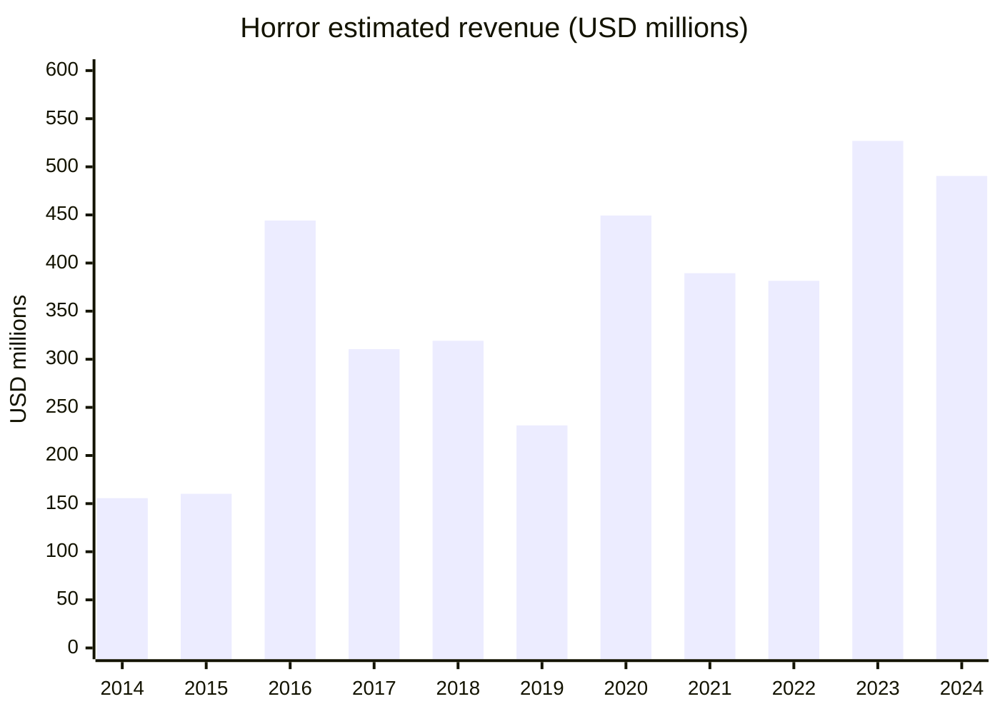
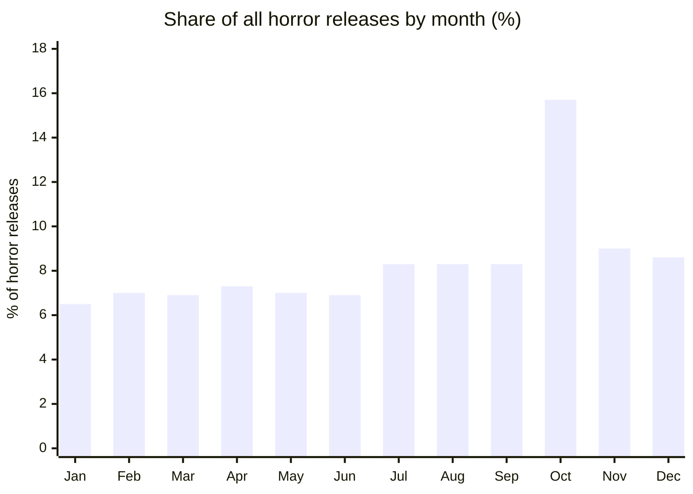

# Steam Horror Analysis: an end-to-end dbt + DuckDB pipeline

A dbt project that turns a raw Kaggle dump of Steam games into tested, documented marts on DuckDB, then uses them to answer one question: how big is horror on Steam, and when does it ship?

## Lineage



## Layers

| Layer | Purpose | Materialization | Tests |
|---|---|---|---|
| Seed (`raw_games`) | Raw Steam games CSV, loaded as is | table | 0 |
| Staging (`stg_games`) | Rename to snake_case, cast types, clean sentinel values | view | 2 |
| Intermediate (`int_games_*`) | Unnest list columns (tags, developers, publishers, genres) into one row per item | view | 19 |
| Marts, core (`fct_games`, `dim_genres`) | One row per game with `is_horror` and estimated revenue; genre dimension | table | 14 |
| Marts, horror (`agg_horror_*`) | Aggregates behind the analysis below | table | 15 |

50 tests in total: generic (`not_null`, `unique`, `relationships`) plus singular tests in `tests/` for tag positions, horror-flag examples, revenue examples, ratio ranges, company-suffix handling and cross-mart consistency. Tests are counted under the layer of the model they test.

## How to run

```bash
pip install -r requirements.txt
python scripts/download_data.py        # downloads the Kaggle CSV into seeds/ (~400 MB, git-ignored)
dbt seed
dbt build                              # runs models and tests
dbt docs generate && dbt docs serve    # lineage graph and column docs
```

The repo ships a local `profiles.yml` (dbt picks it up from the project folder), so no `~/.dbt` setup is needed.

## Modeling decisions

- **Horror is a tag, not a genre.** Steam has no "Horror" genre; it exists only as user tags. A game counts as horror if `Horror`, `Psychological Horror` or `Survival Horror` is in its **top 5 tags** (Steam orders tags by votes).
- **Why top 5.** Without the rule, HELLDIVERS 2 and Path of Exile 2 (Horror at tag position 18 of 20) counted as horror and inflated 2024 horror revenue from about $491M to about $3.4B.
- **Commas inside studio names.** Studio lists are separated by `,`, but `, ` belongs inside names (for example `KRAFTON, Inc.`). The shared macro `split_list_column` protects it. It also re-attaches suffixes glued on with no space (`Rideon,Inc.` becomes `Rideon, Inc.`), so a few names differ from the raw text by one space.
- **Broken upstream header.** The Kaggle CSV header contains `DiscountDLC count`; `scripts/download_data.py` fixes it to `Discount,DLC count`.
- **Metacritic score 0 means "no score"** and is stored as null.
- **Revenue is an estimate:** `price x midpoint of the estimated-owners range`. It ignores discounts, regional pricing, free-to-play and in-game purchases.

## Horror on Steam (2014-2024)

Analysis window is release years 2014-2024. Shares use all games released that year as the denominator. Figures come from the marts as of 2026-10-27 (`docs/results/horror-snapshot.md`).

### Horror by year





| Year | All games | Horror games | Horror share | Horror est. revenue | Share of all est. revenue |
|---|---|---|---|---|---|
| 2014 | 1,523 | 82 | 5.4% | $155.7M | 7.8% |
| 2015 | 2,515 | 151 | 6.0% | $160.2M | 6.1% |
| 2016 | 4,141 | 230 | 5.6% | $444.2M | 11.2% |
| 2017 | 5,922 | 271 | 4.6% | $310.5M | 9.8% |
| 2018 | 7,461 | 344 | 4.6% | $319.2M | 7.0% |
| 2019 | 7,243 | 336 | 4.6% | $231.3M | 6.5% |
| 2020 | 8,804 | 518 | 5.9% | $449.4M | 7.8% |
| 2021 | 11,067 | 528 | 4.8% | $389.5M | 4.2% |
| 2022 | 12,288 | 635 | 5.2% | $381.5M | 6.3% |
| 2023 | 14,598 | 780 | 5.3% | $526.9M | 7.9% |
| 2024 | 20,033 | 1,433 | 7.2% | $490.5M | 3.0% |

Takeaways:
- Horror holds a steady 4.6-6.0% of releases, then jumps to 7.2% in 2024 (1,433 games, nearly double 2023's 780 after a catalog that grew about 37%).
- Revenue share is far more volatile (3.0-11.2%): a handful of hits drive it. 2024 has the most horror games but the lowest revenue share, because total Steam revenue that year ($16.1B) outgrew horror's.

Highest-earning horror games in the window (estimated): Dead by Daylight (2016, $280M), Phasmophobia (2020, $210M), The Forest (2018, $161M), Little Nightmares (2017, $150M), Sons Of The Forest (2024, $139M).

### Top 10 developers and publishers

These are rankings by **number of horror games**, not by revenue (tie-break: estimated revenue, then name). Revenue leaders differ: CAPCOM is in the developer top 10 by count and has by far the most revenue in the list.

| # | Developer | Horror games | Est. revenue |
|---|---|---|---|
| 1 | Anamik Majumdar | 20 | $0.3M |
| 2 | Chilla's Art | 19 | $3.4M |
| 3 | Vidas Salavejus | 19 | $2.8M |
| 4 | David Szymanski | 12 | $13.5M |
| 5 | Euphoric Brothers | 9 | $2.6M |
| 6 | Playstige Interactive | 9 | $0.7M |
| 7 | VikTor | 9 | $0.4M |
| 8 | Yai Gameworks | 9 | $0.2M |
| 9 | CAPCOM Co., Ltd. | 8 | $315.2M |
| 10 | Notovia | 8 | $4.9M |

| # | Publisher | Horror games | Est. revenue |
|---|---|---|---|
| 1 | Anamik Majumdar | 20 | $0.3M |
| 2 | Chilla's Art | 18 | $3.3M |
| 3 | Vidas Salavejus | 17 | $2.1M |
| 4 | SA Industry | 17 | $1.5M |
| 5 | tinyBuild | 15 | $12.4M |
| 6 | PLAYISM | 14 | $14.0M |
| 7 | DreadXP | 14 | $10.9M |
| 8 | Piece Of Voxel | 13 | $0.4M |
| 9 | Gamirror Games | 11 | $22.2M |
| 10 | Conglomerate 5 | 10 | $0.3M |

### When horror ships: October



| Month | Horror games | Share of horror releases | Share of all releases |
|---|---|---|---|
| Jan | 346 | 6.5% | 6.7% |
| Feb | 373 | 7.0% | 7.4% |
| Mar | 366 | 6.9% | 8.0% |
| Apr | 390 | 7.3% | 7.8% |
| May | 374 | 7.0% | 8.5% |
| Jun | 366 | 6.9% | 7.5% |
| Jul | 443 | 8.3% | 8.4% |
| Aug | 441 | 8.3% | 8.9% |
| Sep | 442 | 8.3% | 8.8% |
| **Oct** | **834** | **15.7%** | **9.8%** |
| Nov | 476 | 9.0% | 9.3% |
| Dec | 457 | 8.6% | 9.0% |

October is the Halloween effect: 15.7% of all horror games launch that month, against 9.8% for the full catalog, and the count (834) is 75% above the next-busiest month (Nov, 476).

### Limitations

- 2025 and 2026 are excluded: they are incomplete in the source.
- Many recent games have no tags yet, so the horror share may be understated for recent years.
- The top-5 rule is a judgment call. The Forest and Sons Of The Forest qualify through `Horror` at tag position 4-5 (survival-horror borderline).
- Revenue is the estimate described above, not reported sales. Use it to compare, not as an absolute.
